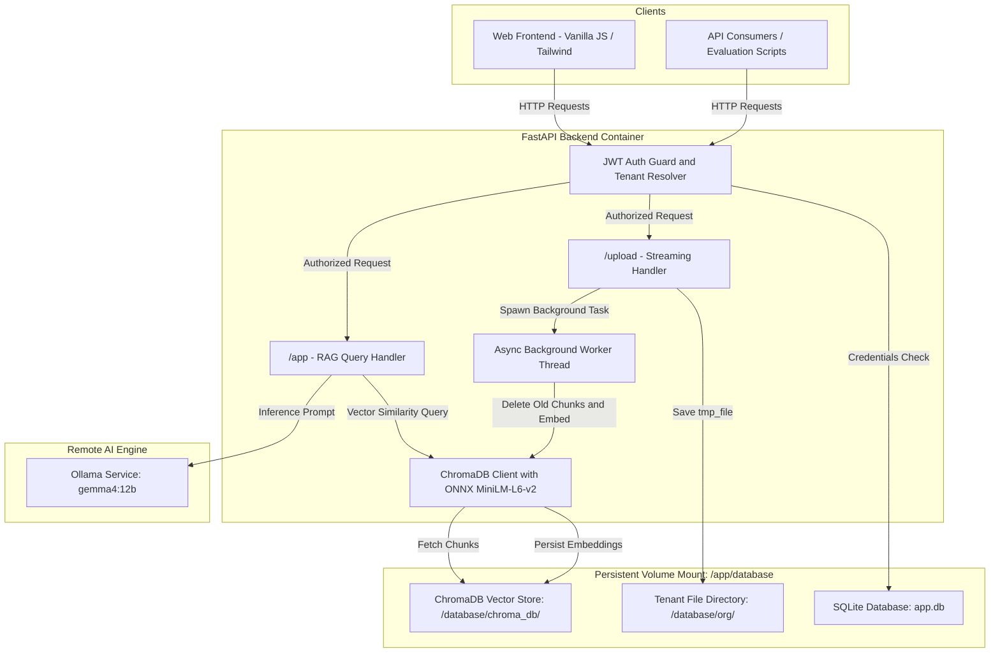
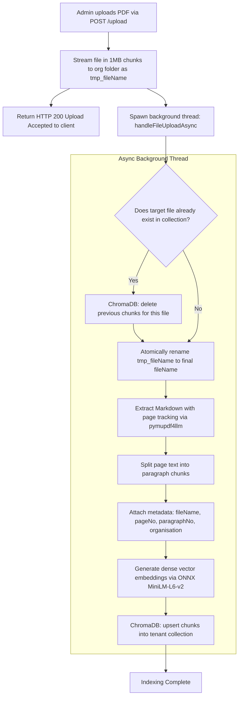
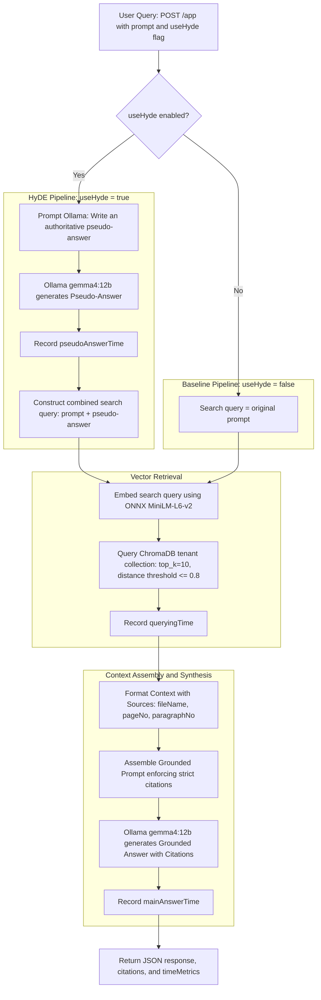

# Chipmunk

A secure, multi-tenant Retrieval-Augmented Generation (RAG) backend for querying organizational policy documents. Built with FastAPI, ChromaDB, ONNX embeddings, and Ollama (`gemma4:12b`).

## Product Demo
https://github.com/user-attachments/assets/39ae1c1a-0629-4a9b-b483-3d452e6fef54

---

## Table of Contents

- [Features](#features)
- [System & Model Architecture](#system--model-architecture)
  - [1. High-Level System Architecture](#1-high-level-system-architecture)
  - [2. Async Document Ingestion & Indexing Pipeline](#2-async-document-ingestion--indexing-pipeline)
  - [3. RAG Query & Inference Pipeline (Baseline vs. HyDE)](#3-rag-query--inference-pipeline-baseline-vs-hyde)
- [Quickstart Commands](#quickstart-commands)
  - [1. One-Command Full Stack Orchestration (`run.sh`)](#1-one-command-full-stack-orchestration-runsh)
  - [2. Manual Container Build](#2-manual-container-build)
  - [3. Manual Run Backend Container](#3-manual-run-backend-container)
  - [4. Run Performance & Accuracy Evaluations](#4-run-performance--accuracy-evaluations)
  - [Additional Commands & Local Development](#additional-commands--local-development)
- [Evaluation Results](#evaluation-results)
  - [Performance & Accuracy Metrics](#performance--accuracy-metrics)
  - [Key Observations](#key-observations)
- [Output Artifacts](#output-artifacts)

---

## Features

- **Multi-Tenant Isolation**: Independent vector collections and document storage per organization.
- **Async Indexing Pipeline**: Chunked streaming file uploads with background deletion and re-indexing.
- **Granular Citations**: Formatted document citations referencing exact file, page number, and paragraph number.
- **Optional HyDE**: Hypothetical Document Embeddings toggle for enhanced query semantic retrieval.
- **Per-Step Latency Profiling**: Returns time spent on pseudo-answer generation, vector querying, and LLM synthesis.
- **Policy Updation**: Company policies & same documents can be updated on the go.
- **Authentication**: JWT based User Authentication (1 hour time window)
- **Ollama (OpenAI compatible)**: Uses ollama/python, OpenAI compatible API
- **Metrics**: Includes Bert/Rouge Scores for each pipline (Baseline & HyDE).
---

## System & Model Architecture

### 1. High-Level System Architecture

Chipmunk isolates tenants at the database, filesystem, and vector index levels. Incoming requests are authenticated via JWT tokens carrying tenant and role claims.



---

### 2. Async Document Ingestion & Indexing Pipeline

Documents are uploaded in 1 MB chunks to prevent memory spikes. All PDF extraction, parsing, embedding, and vector storage occur in a decoupled background daemon thread.



---

### 3. RAG Query & Inference Pipeline (Baseline vs. HyDE)

Queries support both direct semantic search (Baseline) and Hypothetical Document Embeddings (HyDE). In HyDE mode, an intermediate pseudo-answer is generated to bridge lexical and conceptual gaps before vector search.



---

## Quickstart Commands

### 1. One-Command Full Stack Orchestration (`run.sh`)
Launch the complete application stack (backend container + frontend static server) using the all-in-one orchestration script:
```bash
chmod +x run.sh
./run.sh
```

**Workflow**:
1. **Admin Password**: Prompts user for `ADMIN_PASSWORD` (input masked).
2. **Secret Key**: Prompts user for `SECRET_KEY` (press Enter to auto-generate a secure 32-byte hex key).
3. **Container Build**: Auto-detects Podman or Docker and builds `chipmunk-backend:latest`.
4. **Backend Startup**: Runs the backend container in detached mode on port `8000`, mounts `./database:/app/database:Z`, and waits for the health check at `http://localhost:8000/`.
5. **Frontend Server**: Starts the frontend portal at `http://localhost:3000` via `python -m http.server 3000`.
6. **Clean Teardown**: Pressing `Ctrl+C` gracefully stops both the frontend server and backend container.

> Non-interactive mode is also supported: `ADMIN_PASSWORD="pw" SECRET_KEY="key" ./run.sh`

---

### 2. Manual Container Build
```bash
podman build -t chipmunk-backend:latest .
```

### 3. Manual Run Backend Container
```bash
podman run -d \
  --name chipmunk-backend \
  -p 8000:8000 \
  -v $(pwd)/database:/app/database:Z \
  -e ADMIN_PASSWORD="admin_password" \
  -e SECRET_KEY="at_least_32_bytes_super_secret_key" \
  localhost/chipmunk-backend:latest
```

### 4. Run Performance & Accuracy Evaluations
```bash
# Run baseline evaluation (all 200 questions across 4 benchmark suites)
.venv/bin/python tests/evaluate.py

# Run evaluation with HyDE enabled
.venv/bin/python tests/evaluate.py --use-hyde
```

<details>
<summary><b>Additional Commands & Local Development</b></summary>

### Local Development (without Podman)
```bash
# Setup virtual environment and dependencies
python3 -m venv .venv
source .venv/bin/activate
pip install -r backend/requirements.txt
pip install rouge-score bert-score torch

# Launch backend
uvicorn backend.main:app --host 0.0.0.0 --port 8000 --reload
```

### Evaluation Script Options
```bash
# Run a quick smoke test (1 question per test suite)
.venv/bin/python tests/evaluate.py --limit 1

# Re-score existing output files without running model queries
.venv/bin/python tests/evaluate.py --score-only
.venv/bin/python tests/evaluate.py --use-hyde --score-only
```

### Sample API Requests (curl)
```bash
# 1. Login as root administrator
curl -X POST http://127.0.0.1:8000/login \
  -H "Content-Type: application/json" \
  -d '{"organisation":"root","userName":"admin","password":"admin_password"}'

# 2. Create an organization admin (requires root Bearer token)
curl -X POST http://127.0.0.1:8000/createUser \
  -H "Authorization: Bearer <ROOT_TOKEN>" \
  -H "Content-Type: application/json" \
  -d '{"organisation":"aethertech","userName":"aethertech_admin","password":"pw"}'

# 3. Upload a policy PDF (requires org admin token)
curl -X POST http://127.0.0.1:8000/upload \
  -H "Authorization: Bearer <ORG_TOKEN>" \
  -F "file=@tests/data/pdf/v1/aethertech_policy.pdf"

# 4. Query policy with RAG
curl -X POST http://127.0.0.1:8000/app \
  -H "Authorization: Bearer <ORG_TOKEN>" \
  -H "Content-Type: application/json" \
  -d '{"prompt":"Who is eligible for shared cabs?","useHyde":false}'
```
</details>

---

## Evaluation Results

Evaluations were performed across 4 test suites (50 questions each, 200 total) against ground truth answers using **ROUGE** (`rouge1`, `rouge2`, `rougeL`) and **BERTScore** (`roberta-large` F1), alongside average and 95th percentile response times (`p95`).

### Performance & Accuracy Metrics

| Test Suite | Mode | Questions | Avg Time (s) | **p95 Time (s)** | ROUGE-1 | ROUGE-L | BERTScore F1 |
| :--- | :--- | :---: | :---: | :---: | :---: | :---: | :---: |
| **aethertech_v1** | Baseline | 50 | **1.601s** | **2.123s** | 0.4884 | 0.4651 | 0.9016 |
| | HyDE | 50 | 10.133s | 13.869s | **0.5037** | **0.4833** | **0.9031** |
| **nexacore_v1** | Baseline | 50 | **1.680s** | **2.946s** | 0.4714 | 0.4297 | 0.8959 |
| | HyDE | 50 | 9.391s | 12.563s | **0.4857** | **0.4496** | **0.8973** |
| **vanguard_v1** | Baseline | 50 | **1.655s** | **2.145s** | **0.5177** | **0.4773** | **0.9036** |
| | HyDE | 50 | 9.080s | 11.822s | 0.5024 | 0.4750 | 0.9031 |
| **aethertech_v2** | Baseline | 50 | **1.601s** | **2.322s** | 0.4653 | 0.4333 | 0.8943 |
| | HyDE | 50 | 9.499s | 12.263s | **0.4767** | **0.4393** | **0.8946** |

### Key Observations
- **Retrieval Quality**: HyDE improves ROUGE-1 and ROUGE-L across most test suites (+1.0% to +2.0%) by aligning query vocabulary with document embeddings before vector search.
- **Latency Trade-off**: Baseline responds in ~1.6s (p95 ~2.1s–2.9s), whereas HyDE requires ~9.0s–10.1s (p95 ~11.8s–13.8s) due to the extra pseudo-answer generation pass before context retrieval.

---

## Output Artifacts

- **Baseline Results**: `tests/results/baseline/` (`evaluation_summary.json` and `*_results.jsonl`)
- **HyDE Results**: `tests/results/hyde/` (`evaluation_summary.json` and `*_results.jsonl`)
